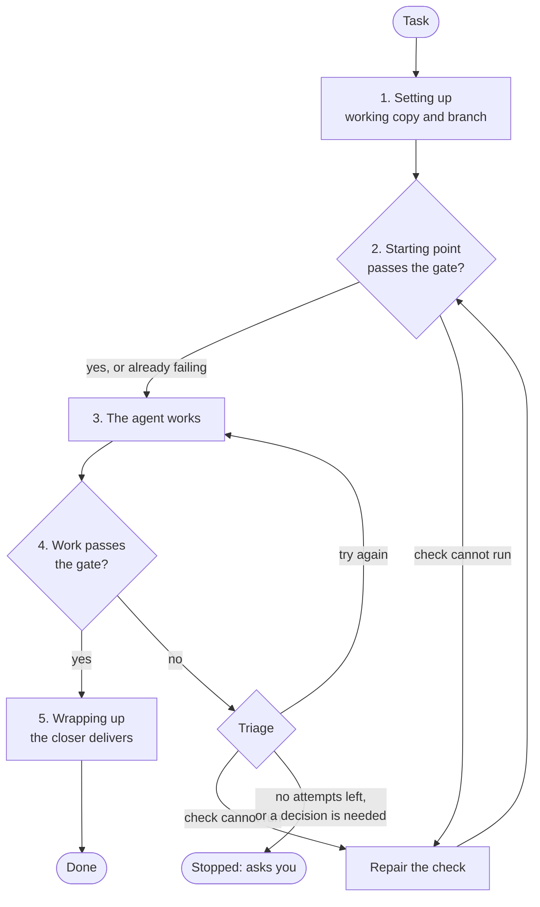

# How it works

This page explains the model behind the `delivery` command: what a run is made of, who decides
what, and what happens when something goes wrong. Read it after [Get started](getting-started.md)
to learn why the command behaves as it does. To do something, use a guide:
[Run a task](run-a-task.md), [Work through a task list](run-a-task-list.md) or
[Set up a project](project-configuration.md). In this documentation, delivery-service is also
called the harness.

## The agent proposes; your gate decides

delivery-service hands a task to an AI agent and does not take the agent's word for the
result. The agent works on its own copy of your repository. When it says it has finished, a
check that you chose, such as `npm test`, runs against that copy. The harness calls this check the
gate, and the work counts as done only if the gate passes.

The gate is ordinary code with a yes or no answer, so the same work always gets the same verdict.
That is the sense in which the harness is deterministically gated: the agent's output can vary,
but the verdict on it cannot.

## The parts of a run

| Part | What it is | Where you set it |
|---|---|---|
| Task | One thing you want done, in plain English | `task` or `tasks` in the config file, or `--task` |
| Worker | The agent that does the task, on a copy of your repository | [Configure a role](configuring-a-role.md) |
| Gate | The check that decides whether the work is good | [Write a gate](writing-a-gate.md) |
| Closer | What happens to work that passes: commit to a branch, merge back, or open a pull request | [Write a closer](writing-a-closer.md) |
| Budgets | How many attempts each kind of setback gets before a person is asked | [Configuration reference](configuration-reference.md) |
| Record | The run's step-by-step account, kept in `.delivery/runs/` in your repository | [See what happened to a run](check-a-run.md) |

The agent never touches your own checkout. It works in a separate working copy. Where the
machine supports it (Linux, with bubblewrap), a fence also keeps your main folder read-only. The
`fence` setting controls whether the fence is preferred, required or off.

## What happens to a task

A run normally moves through these steps, and each one is printed as it happens. A setback adds
steps (see the next section):

1. **Setting up.** A working copy and a branch are created for the task.
2. **Checking the starting point.** The gate runs before the agent starts, so the agent is not
   blamed for a check that is already failing.
3. **The agent is working.** The worker does the task.
4. **Checking the agent's work.** The gate runs again.
5. **Wrapping up.** The closer delivers the work.

The diagram shows the same steps, with the setbacks that can send a run back, covered in the next section.

The branch is `surface/<run id>`: `surface` is the harness's word for a task's working unit, and
the run id is the first words of the task followed by the start time, for example
`surface/add-a-page-that-shows-20260917T090000Z`.

## When something goes wrong

A failing check does not end the run. The harness sorts each setback and decides what to do next.
This decision is called triage:

- The agent is sent back to try again, with a sharper brief that says what failed and which dead
  ends to avoid.
- The check itself is repaired, when the check cannot run at all rather than failing.
- The run stops and asks a person, when no attempts remain or the agent says it needs a decision.

Each kind of retry has a budget (`correction`, `gateError`, `gateMaintenance`, `terminus` and
`close`; see [budgets](configuration-reference.md#budgets)), so a run cannot loop forever. A run that stops for a decision exits with code 4 and
names the decision. See the [exit codes](cli-reference.md#exit-codes).

## Runs survive interruption

The record is written as the run goes, so closing the terminal or restarting the machine loses
nothing. Run `delivery run` again in the same repository and the run continues from the step it
had reached. See [Pick up an interrupted run](resume-a-run.md).

## One task, a list, or a backlog

The same run can be driven three ways:

- **One task:** `delivery run --task "..."`.
- **A list:** the `tasks` in your config file, worked in order, one at a time or several at once
  with `concurrency`. See [Work through a task list](run-a-task-list.md).
- **A backlog:** work items kept in `.delivery/backlog/`, plus other sources such as GitHub issues,
  worked by `delivery run --sources`. See [Work through a backlog](work-a-backlog.md).

Tasks that run at once share one repository and, usually, one environment. If that environment
breaks, the run pauses the tasks about to check or hand off their work, repairs the environment
once, and carries on. See
[When the shared environment breaks](shared-environment.md).

## The delivery branch

When a run works several items, such as a backlog, they do not each get a branch for you to
merge. Every item lands on one branch, `delivery/<base>` (for example `delivery/main`). Each item
starts from that branch's latest work, so it sees everything delivered before it, and you review
one branch rather than many.

When another item lands while one is still working, the later one is rebuilt on top and its gate
runs again before it lands. If that rebuild conflicts or the gate fails, the item gets a fresh
attempt from the latest work, shown what went wrong, within its usual corrections. Nothing that
conflicts or fails is ever added to the delivery branch.

Your closer acts once per run, on the delivery branch, once at least one item has landed:
`merge-back` merges it into your base branch, `commit-to-branch` leaves it for you to merge, and
`open-pr` opens one pull request for it. If the closer does not succeed, the delivery branch stays
as it is and the next run tries again.

If you commit to your base branch yourself, the next run brings those commits into the delivery
branch first, and runs your gate on the result. If that conflicts or the gate fails, the run
starts no task and says what is in the way. It says so again on later runs, without trying the
same thing again, until your base branch or the delivery branch moves.

To use it, see [Work through a backlog](work-a-backlog.md).

## Reading the outcome

Two commands read a run without changing it. `delivery status` gives the full account of one run,
including how it got there. `delivery report` gives your whole task list in plain words and says
what to do next. Both can print versioned JSON for scripts: see [Reports as data](reporting.md).

## Next steps

- [Get started](getting-started.md): finish a first run.
- [Set up a project](project-configuration.md) and [Work through a backlog](work-a-backlog.md): put the model to use.
- [Configuration reference](configuration-reference.md) and [Glossary](glossary.md): the settings and terms.
