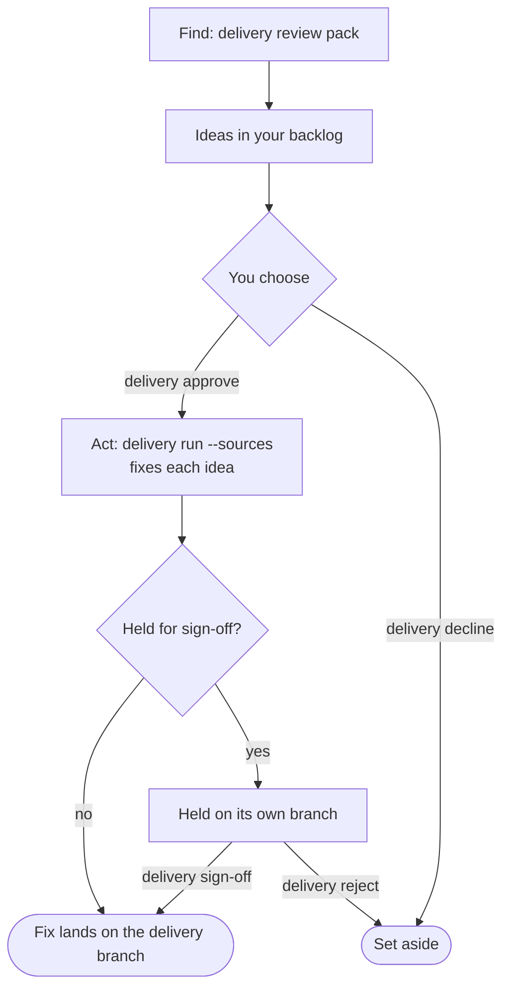

# Packs

A pack is a shareable, repeatable find-then-act job: an agent finds work in your project and adds it to your backlog as ideas, you choose which to act on, and an agent acts on each, checked by your own tests. A review is one kind; moving off code your team marked as replaced is another. The built-ins are `code`, `security` and `deprecations`.

## The packs that come with the harness

Three packs come with the harness, and every project can use them without setting anything up:

- **`code`**: Looks for code that gives wrong results, code nothing uses, missing handling of things going wrong, the same job done different ways, and shortcuts the code admits to. Start it with `delivery review code`.
- **`security`**: Looks for passwords and keys written in the code, outside input reaching commands or queries, missing checks on who may do what, unsafe default settings, and library versions known to be unsafe. Start it with `delivery review security`.
- **`deprecations`**: Finds places that still use code your team has marked as replaced, and moves them. Start it with `delivery review deprecations`; the [how-to](move-off-deprecated-code.md) walks through it.

`delivery packs` prints the same packs:

```text
Packs you can use:
  code          Looks for code that gives wrong results, code nothing uses, missing handling of things going wrong, the same job done different ways, and shortcuts the code admits to. Start it with: delivery review code
  deprecations  Finds places that still use code your team has marked as replaced, and moves them. Start it with: delivery review deprecations
  security      Looks for passwords and keys written in the code, outside input reaching commands or queries, missing checks on who may do what, unsafe default settings, and library versions known to be unsafe. Start it with: delivery review security

To use a pack folder of your own, list it under packs in delivery.config.json.
To add a pack someone has published on npm: delivery packs add <package>
See exactly what a pack will do: delivery packs inspect <name>
```

## How a pack runs

Every pack runs the same loop. You decide at two points: which ideas to act on, and which held fixes to land.



`delivery review <pack>` starts any pack's find, and the command keeps its name for every pack. The loop, step by step:

1. `delivery review <pack>` runs the find and adds its ideas to your backlog.
2. `delivery backlog` lists the ideas, and any held fixes waiting for you.
3. `delivery approve` chooses ideas to act on, and `delivery decline` sets them aside.
4. `delivery run --sources` acts on each approved idea.
5. `delivery sign-off` lands a held fix, and `delivery reject` sets it aside, leaving its work on its branch.
6. `delivery report` says what happened.

## What a pack cannot promise

- A find is an agent's opinion. "Nothing found" is the agent's reading of your project, not a guarantee that nothing is wrong.
- One find writes at most 40 ideas. When it reaches that cap it says `There may be more: run it again once these have landed.`, which is `MAY_BE_MORE` in the harness.
- "Done" is only as strong as the check and the tests behind it. A fix that passes weak tests is done in name only.
- Which held work waits for your sign-off depends on the severity the agent assigns to each idea.
- A pack holds only data, so it cannot run code of its own.

## Inspect a pack before you use it

`delivery packs inspect <pack>` shows what a pack will do before you use it: each workflow, how far it goes before it asks you, the checks and landing it uses, and every instruction the agent is given. It reads the pack; it does not run it. Use it on a built-in pack, or on a pack folder of your own, before you list the folder under `packs`.

The example below is the account of the built-in `deprecations` pack. It is run with `delivery packs inspect deprecations` from a folder outside any project, which is why "Checks and landing" says the checks are not known. The top three lines name the pack, its version and a fingerprint; the fingerprint changes if any instruction changes, so a changed pack shows a new one.

```text
Pack: Move off deprecated code
deprecations, version 1.0.0, built in to delivery-service.
Fingerprint, which changes if any instruction changes:
  092e2720c651caaf92e9f20236ae67bd
  58eeb672ffe82c2d077d2de86696a626

In short
  Finds places that still use code your team has marked as
  replaced, and moves them.
  It has 3 workflows. A find reads your project and adds
  ideas to your backlog; an act changes the project for one
  idea.
  scan (find): Reads your project and adds ideas to your
    backlog. It changes nothing else.
  code (act): Code of the project's own that still calls the
    deprecated code.
  tests (act): A test file that still calls the deprecated
    code.
  An idea from "scan" may go to "code" or "tests", and only
  after you approve it.

What it may touch
  This pack cannot give the agent extra powers, and nothing
  in it takes any away. Its instructions run with everything
  your own agent setup can already do:
  Your own Claude Code settings, CLAUDE.md, skills, plugins,
  hooks and MCP servers also apply.
  It can use every tool your setup allows.
  What stops a bad change landing is your project's own
  checks, the guards below, and the sign-off step where a
  workflow has one.
  After a change from an act workflow lands, your project's
  own follow-on steps run.

How far each workflow goes before it asks you
  Every workflow is refused if it:
  - deletes or renames a test
  - changes how the tests run, such as a test-runner setting
    or a CI file
  - adds a skip marker to a test
  - hides a test, test setting or skip from git
  - edits or removes an existing backlog item, rather than
    adding a new one
  scan:
    Also refused if it changes anything other than adding
    ideas to the backlog.
    Its ideas wait for you to approve them before any act
    workflow runs.
  code:
    Also refused if it edits an existing test.
    Ideas rated high or critical wait for your sign-off
    before they land.
  tests:
    No extra guards.
    Lands without asking you again, once you have approved
    the idea.

Checks and landing
  This pack chooses no checks and no way of landing. Every
  workflow uses your project's own.
  No project was found here, so which check and landing
  would be used is not known.

Does it widen what the agent may do?
  Nothing in this pack widens what the agent may do beyond
  your project's defaults.
  Compared: guards, sign-off, checks, landing, follow-on
  steps and agent options.
  The instructions themselves are not analysed, so read
  them.

Things to look at
  1. "tests" lands without asking for your sign-off once you
     have approved the idea.

Questions to ask before you use it
  Do you know who wrote it?
  Do the instructions below match the summary above?
  Does anything in them ask for something your project does
  not need?

Fixtures
  Not read when the pack is used; only delivery packs check
  reads them, to prove the pack works. Not shown here:
  fixtures/expect.json, 530 bytes
  fixtures/fixes.json, 2325 bytes
  fixtures/project/lib/dates.js, 373 bytes
  fixtures/project/lib/legacy-dates.js, 272 bytes
  fixtures/project/package.json, 96 bytes
  fixtures/project/src/invoice.js, 163 bytes
  fixtures/project/src/invoice.test.js, 302 bytes
  fixtures/project/src/receipt.js, 148 bytes
  fixtures/project/src/receipt.test.js, 482 bytes
  fixtures/review.json, 3194 bytes
```

Read the account from the top:

**In short** says what the pack is for and lists its workflows. A find workflow only reads your project and adds ideas to your backlog. An act workflow changes the project for one idea, and runs only after you approve that idea.

**What it may touch** says what the instructions can do beyond what your own setup allows. Here the pack gives the agent no extra powers and takes none away; your own Claude Code settings, checks and sign-off still apply.

**How far each workflow goes before it asks you** lists what each workflow is refused for, such as deleting a test, and what it asks you before it does. A workflow with a sign-off step holds its fixes until you approve them.

**Checks and landing** says which checks a change must pass, and how it lands. A pack that chooses none uses your project's own. If the account says the checks are not known, run the inspection from inside your project to see the ones it would use.

**Does it widen what the agent may do?** says whether the pack grants more than your project's defaults. It compares the guards, sign-off, checks, landing, follow-on steps and agent options. A "nothing widened" answer does not mean the instructions are harmless; read them.

**Things to look at** lists the sentences the account flags for you to put to the pack's author. Each one is a question to answer before you use the pack.

**Questions to ask before you use it** are three questions to put to the pack before you use it: who wrote it, whether the instructions match the summary above, and whether they ask for more than your project needs.

**Fixtures** names each fixture file with its size. The account does not read them: only `delivery packs check` runs them, to prove the pack works.

The instructions follow the account, one block for each step of each workflow. Each block sits between two lines of dashes. Its words are the pack's own, apart from the lines that delivery-service adds to every find so the agent writes ideas in the right form; those lines sit in a block of their own under the pack's words. Read every line: the instructions are what the agent is told to do.

`--workflow <name>` shows only one workflow, its limits and its instructions, with the pack's name, fingerprint and standing notes. `--json` prints the same account as one versioned document for scripts. Both are in the [command reference](cli-reference.md).

## What inspection does not promise

Inspection is a reading aid, not a guarantee. It does not analyse the instructions: they are what the agent follows, so they are the part to read. Nothing unusual found means nothing unusual in what the command checks, not that the pack is harmless.

Inspection also checks the pack's folder before it shows anything. It allows `pack.json`, the instruction files it names, a `fixtures` folder, README, licence and changelog files, a top-level `.git/` folder, and the housekeeping names `.gitignore`, `.gitattributes`, `.DS_Store` and `Thumbs.db`. It refuses a link anywhere in the folder, a script or any other file the format does not name, a folder it does not name, an instruction file no workflow names, and an instruction file that is not valid UTF-8 text. A refusal shows nothing from the pack, and exits with code 2.

A pack that `delivery review` already runs keeps running with a stray file in its folder; only inspection refuses it. For example, a pack folder with a script named `install.sh` is refused like this:

```text
Not read: their-pack
  their-pack/install.sh is not part of a pack: a pack folder
    holds only its pack.json, the instruction files it
    names, a fixtures folder, and README, licence or
    changelog files, so a script or any other file cannot
    come with it.
  If you wrote this pack, remove what is named above. If
  someone else did, ask them why it is there.
  Nothing from this pack was shown, run or sent to an agent.
```

## Add a pack from elsewhere

A pack can be published on npm, as any package is. You add one to your project with `delivery packs add`, and the pack is then kept in your repository, so every run uses the pack you read. Each example below is what the command prints.

**Find a pack.** A publisher gives the package the npm keyword `delivery-pack`, and a `delivery-pack` field in its `package.json` that names the pack's folder. To search for packs, run:

```bash
npm search keywords:delivery-pack
```

delivery-service does not host packs. They come from npm.

**Add it.** Run `delivery packs add @acme/delivery-pack-docs`. The command shows the package's version and the pack's account before it asks you anything, and nothing from the package runs. The start of the account looks like this:

```text
Found @acme/delivery-pack-docs on npm.
  Version: 1.2.0
Nothing is added until you say yes. Nothing from the package
is run: its install scripts and its own dependencies are
never used.

Pack: Document drift
docs-drift, version 1.0.0, from npm:
@acme/delivery-pack-docs 1.2.0.
Fingerprint, which changes if any instruction changes:
  63f75c73c061615868151b075594454e
  bef582312e3885c5a25245c734b7634f
```

The account goes on to name the pack's workflows, what the pack may touch and the instructions it gives the agent. The pack takes its name from its own `pack.json`, here `docs-drift`. When you answer the question with a yes, the command writes the pack and names the two items to commit:

```text
Add docs-drift 1.2.0 to this project?
Added docs-drift 1.2.0.
  Recorded: .delivery/packs.lock.json
  Kept as:  .delivery/packs/docs-drift
Commit both, so everyone gets this same pack.
See its workflows:  delivery packs
Read it again:      delivery packs inspect docs-drift
```

**From a job with no terminal.** A scheduled job, or any command with nobody at a terminal, has nobody to ask. Then `delivery packs add` shows the account, writes nothing and refuses. It prints the command to run again, with the fingerprint that the account shows:

```text
Not added: nothing here can ask you.
  Read the account above, then add it with the fingerprint
  you read:
    delivery packs add @acme/delivery-pack-docs \
      --approve 63f75c73c061615868151b075594454e\
bef582312e3885c5a25245c734b7634f
  The command is refused if the pack has a different
  fingerprint.
  Nothing was changed.
```

The command is printed so that a shell reads it as one line: each backslash at the end of a line joins the next line to it. Paste it as it is, with the fingerprint from the account you read. Run with that fingerprint, the same command adds the pack and ends like this:

```text
Added docs-drift 1.2.0.
  Recorded: .delivery/packs.lock.json
  Kept as:  .delivery/packs/docs-drift
Commit both, so everyone gets this same pack.
See its workflows:  delivery packs
Read it again:      delivery packs inspect docs-drift
```

A different fingerprint is refused, and nothing is written. To read the packs in a script, use `delivery packs --json`. It prints one document, `delivery.packs/1`, that lists each pack in the project with its source, its version and its state:

```json
{
  "packs": [
    {
      "name": "code",
      "source": {
        "kind": "built-in",
        "package": null
      },
      "state": null,
      "summary": "Looks for code that gives wrong results, code nothing uses, missing handling of things going wrong, the same job done different ways, and shortcuts the code admits to.",
      "title": "Code review",
      "version": "2.0.0"
    },
    {
      "name": "deprecations",
      "source": {
        "kind": "built-in",
        "package": null
      },
      "state": null,
      "summary": "Finds places that still use code your team has marked as replaced, and moves them.",
      "title": "Move off deprecated code",
      "version": "1.0.0"
    },
    {
      "name": "security",
      "source": {
        "kind": "built-in",
        "package": null
      },
      "state": null,
      "summary": "Looks for passwords and keys written in the code, outside input reaching commands or queries, missing checks on who may do what, unsafe default settings, and library versions known to be unsafe.",
      "title": "Security review",
      "version": "2.0.0"
    },
    {
      "name": "docs-drift",
      "source": {
        "kind": "installed",
        "package": {
          "name": "@acme/delivery-pack-docs",
          "version": "1.2.0"
        }
      },
      "state": "ok",
      "summary": "Finds calls to code the project has marked as replaced.",
      "title": "Document drift",
      "version": "1.0.0"
    }
  ],
  "schema": "delivery.packs/1"
}
```

**Pinned.** Pinning keeps your review stable: every machine and every run uses the pack you read, until you choose to update it. Pinning does not review the pack for you: read the account before you accept it, and read the change before you update.

To keep the pack, commit both items: `.delivery/packs.lock.json`, which records the version and the fingerprint, and the folder `.delivery/packs/docs-drift`, which holds the pack's files.

**Update it.** Run `delivery packs update docs-drift` to take a newer version. It shows what changes first, and writes nothing until you say yes. Here is the start of the change from 1.2.0 to 1.3.0, which removes the sign-off from `code`. The example answers no, so nothing changes:

```text
docs-drift: 1.2.0 to 1.3.0
Fingerprint before:
  63f75c73c061615868151b075594454e
  bef582312e3885c5a25245c734b7634f
Fingerprint after:
  8e850d5010645b5fb788f2cf391601cb
  73293778bb50f3bd6f6f2a66f55c39b5

What changed, in short
  Sign-off: "code" no longer waits for your sign-off.
  Guards: no change.
  Workflows added: none
  Workflows removed: none
  Checks and landing: no change.
  Widens what the agent may do: no.
  New things to look at:
    1. "code" lands without asking for your sign-off once
       you have approved the idea.
  Read the changed lines below. This summary does not cover
    what the instructions say.
```

In automation, the same `--approve` takes the update, given the fingerprint under "Fingerprint after" in the change that the job was shown. A version published since then is refused, because its fingerprint differs. With nobody to ask, the update refuses and prints the command you ran, with `--approve` and that fingerprint. The recorded request does not change unless you give one.

**When a pack is refused.** Every use of a pack first checks its kept files against the record, with no network. If a file has changed, the run is refused. The refusal names the file and the one command that fixes it:

```text
The pack docs-drift is not as you approved it.
  Approved: 1.2.0, from @acme/delivery-pack-docs
  Changed: .delivery/packs/docs-drift/scan.md
  Nothing was sent to an agent.
To go back to the approved pack:
  delivery packs restore docs-drift
```

**Newer format.** A pack kept in a newer pack format than your delivery-service reads is refused, and the refusal ends with the words "upgrade delivery-service to read this pack".

## Names the built-ins keep

Built-in packs load in every project, so their names are taken: `code`, `security` and `deprecations`, and the workflows inside them, `deprecations:scan`, `deprecations:code` and `deprecations:tests`. A pack of your own cannot use these names.

If a pack you list in `delivery.config.json` has the name of a built-in, the harness refuses it and says:

```text
The pack in my-deprecations/pack.json is named "deprecations", the name of a pack that comes with the harness: change its "name" so each pack is named once.
```

A pack added from npm with a built-in's name is refused when you add it, and nothing is written.

## Next steps

- [Review your project](task-packs.md): ask for a review, choose what to fix and sign off serious fixes.
- [Move off deprecated code](move-off-deprecated-code.md): mark code as replaced, find what still uses it and move it.
- [Write a pack](writing-a-pack.md): make a pack of your own and prove it with `delivery packs check`.
- [Inspect a pack](#inspect-a-pack-before-you-use-it): read what a pack will do, and how far it goes, before you use it.
