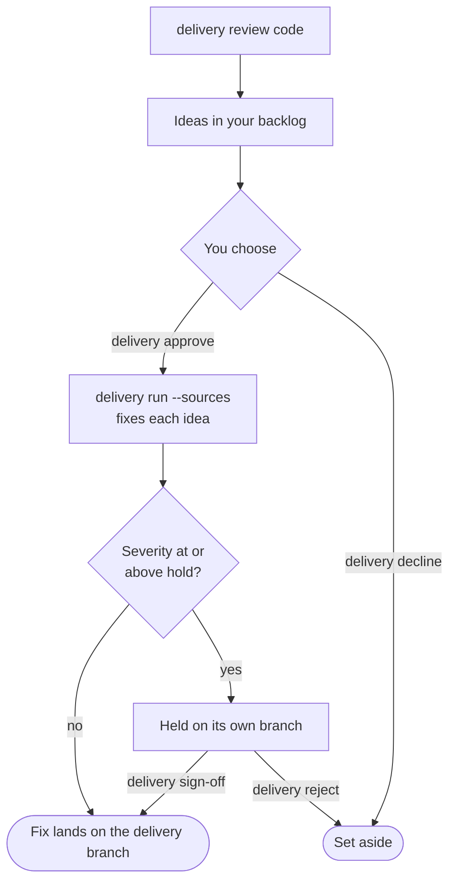

# Review your project

This guide shows how to have an agent review your project, choose which of its findings to fix, and have them fixed. It is for anyone with a [project set up](project-configuration.md) and Claude Code signed in (`claude auth status`).

A review is one kind of [pack](packs.md): a set of instructions that has an agent read your project for one kind of problem. The built-in packs are `code`, `security` and `deprecations`. Each problem a review finds becomes an [idea](glossary.md#idea) in your [backlog](glossary.md#backlog). Nothing is fixed until you choose which ideas to fix.

The review runs in four stages, and you decide at two of them:



## Ask for a review

In your project's folder, type:

```bash
delivery review code
```

```text
Starting run code-review-of-this-project-20261020T192930Z: Code review of this project
- setting up
- checking the starting point
- the agent is working
- checking the agent's work
- wrapping up
- done
Done: the change for "Code review of this project" passed `npm test` and is merged into main.
To look at the work: git log main
The review added 3 ideas to your backlog.
Read them with: delivery backlog
Choose what to fix with: delivery approve <ids>, or delivery approve --all
This run: 1 of 1 task completed and merged.
Run `delivery report code-review-of-this-project-20261020T192930Z` for what to do.
```

Or ask for a security review, which looks for weaknesses an attacker could exploit:

```bash
delivery review security
```

The review is an ordinary run. Its agent reads your project and adds one idea to your backlog for each problem it finds, in plain words. It changes nothing else, and a problem the harness cannot find in your project is not added. The ideas are committed on your current branch; see them with `git log`.

- `delivery review code --path src/auth` reviews only that part of your project.
- `delivery review code --preview` shows what the review agent would be told, with no sign-in and no network, and starts nothing.

A review's list is an agent's opinion. "Nothing to add" means the agent found no problems, not that none exist.

## Read what it found

```bash
delivery backlog
```

```text
Ideas, waiting for you to choose:
  20260101T000000Z-checkout-price-negative  The price shown at checkout can be negative (high)
  20260101T000100Z-settings-error  A missing or broken settings file stops the shop with an unhelpful error (medium)
  20260101T000200Z-legacy-gateway  Old code for a payment provider you no longer use (low)

Read one in full with: delivery backlog <id>
```

`delivery backlog` lists what is waiting: ideas for you to choose, open items to work, held fixes awaiting your sign-off, and parked items that stopped for you. `delivery backlog <id>` shows one in full, with a FOR ENGINEERS block naming its file, the workflow that fixes it and what the harness checks. A password or key found by a review is never shown in full.

`<id>` is the name `delivery backlog` shows for the idea. A distinctive end of it, such as `settings-error`, is enough.

## Choose what to fix

Approve the ideas you want fixed by name:

```bash
delivery approve checkout-price-negative settings-error
```

```text
Approved 2 ideas for fixing: The price shown at checkout can be negative; A missing or broken settings file stops the shop with an unhelpful error.
They are fixed the next time you run: delivery run --sources
```

Approve all of them with `delivery approve --all`. Set the rest aside with `delivery decline <id>...`:

```text
Set aside 1 idea: Old code for a payment provider you no longer use.
```

Both commit only those item files on your current branch.

## Fix the approved ideas

Run the approved ideas through the review's fix workflow:

```bash
delivery run --sources
```

An idea is accepted only once its problem is gone and your tests pass.

## Sign off serious fixes

The harness finishes and checks the fix of a serious problem, then holds it on its own branch. Nothing builds on it. A fix is held when its idea's severity is at or above the `hold` setting of its workflow; the built-in security review holds `high` and `critical`, and the code review holds none. `delivery backlog` lists a held fix under "Held". Read it with `delivery backlog <id>`, then:

- `delivery sign-off <id>` checks it again where it lands, lands it, then hands the delivery branch to your closer;
- `delivery reject <id>` sets it aside; its work stays on its branch.

## Review a GitHub-backed project

On a project whose backlog is GitHub issues, the review raises each idea as an issue without your label. On GitHub, adding the label is the approval: the next `delivery run --sources` fixes each one you label.

## Write your own reviews

`delivery packs` lists every pack you can use, each with a sentence saying what it does and the command that starts it, including any pack folder your project lists under `packs`. List a pack folder of your own under `packs` in `delivery.config.json`, then start it by name with `delivery review <name>`. To write one, see [Write a pack](writing-a-pack.md).

## When something goes wrong

- **Not signed in:** `delivery review` stops with exit 3 and "I can't start the agent that does the work: you're not signed in". Run `claude auth login`, or set `ANTHROPIC_API_KEY`, then try again.
- **An item file you changed but did not commit:** `delivery approve` and `delivery decline` change nothing and say which file has changes. Commit or undo them, then try again.
- **An id that matches nothing:** `delivery backlog <id>` exits 2 with "No item in your backlog is called …". List the ids with `delivery backlog`.

## Next steps

- [Work through a backlog](work-a-backlog.md): how approved ideas are worked
- [Write a pack](writing-a-pack.md): a review of your own
- [Run on a schedule](run-on-a-schedule.md): review and fix without being there
