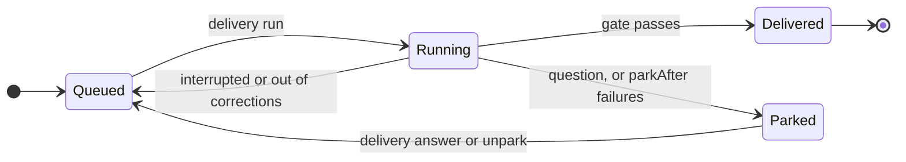

# Work through a backlog

This guide shows how to keep work as items in your repository, have `delivery run --sources` work through them, and deal with an item that is parked. It assumes a [project set up](project-configuration.md) with Claude Code signed in, and a closer chosen (see [Write a closer](writing-a-closer.md)). Item fields are in the [configuration reference](configuration-reference.md#backlog-items).

## Add an item

An item is a Markdown file in `.delivery/backlog/`, named `<timestamp>-<slug>.md`, for example `20261016T090000Z-greet-people.md`, so items added at the same time never collide. The front matter says how it is done; the text after it is the brief the agent receives.

```markdown
---
status: open
workflow: plan-then-build
priority: 10
---
Tidy the greeting copy so it matches the spec.
```

Commit the item, and push it if the repository has an `origin`. The harness reads items from your base branch's last commit, or `origin`'s when the project has one. An item file that exists only on disk is named in the run's output but not worked.

```bash
git add .delivery/backlog/20261016T090000Z-greet-people.md
git commit -m "Add a backlog item to tidy the greeting copy"
```

## Run the backlog

```bash
delivery backlog                # list the ideas, open, held and parked items
delivery run --sources          # take one item
delivery run --sources --max 3  # take up to three items in this run
```

```text
Open, to be worked on the next delivery run --sources:
  20261016T090000Z-greet-people  Tidy the greeting copy so it matches the spec.

Read one in full with: delivery backlog <id>
```

`<id>` is the file name without `.md`, as `delivery backlog` prints it. Ideas come from a [review](task-packs.md); held items wait for [sign-off](use-workflows.md#hold-serious-work-for-your-sign-off). `delivery run --sources` also reads the other [work sources](work-sources.md) in your configuration file, in order: due recurring items first, then each source in turn, and a fallback source only when nothing else has work. `--max N` takes up to N items in one run; the default is one. Each item becomes a run of its own, with its workflow; `--workflow <name>` gives items that name none that workflow.

Every item lands on one delivery branch, `delivery/<base>`, and your closer takes that branch once per run. A delivered item is marked `resolved` on the delivery branch and is not taken again until that branch is merged. See [The delivery branch](concepts.md#the-delivery-branch).

## How an item is carried on

How an item is carried on depends on how its last run ended. The diagram shows where each ending leads:



In words:

- A run that was interrupted (its session stopped before it finished) carries on in the same working copy. Anything left uncommitted there is committed onto the earlier run's branch first, so the work it had done is kept, and its agent session can be resumed.
- A run that used up its corrections starts afresh from the delivery branch. Its old branch is kept for you to look at.
- A question the agent asked parks the item until you answer it.
- An item that ends undelivered `parkAfter` runs in a row (3 by default) is parked. An item that stopped for you is parked the same way.

The record of each item (its last run, how that ended, and whether it is parked) is kept in the item ledger, `ledger/` under your state folder (`~/.local/state/delivery-service/`, or `$XDG_STATE_HOME`), beside the working copies. It stays on this machine: another clone of the repository keeps its own.

## Handle a parked item

A parked item is skipped until you act. `delivery status` shows what is parked and why, and `delivery backlog` lists it under "Parked, stopped for you:". `<item>` is the id `delivery backlog` shows.

If the agent asked a question, answer it; the next run carries on with your answer:

```bash
delivery answer <item> "Use the shorter greeting from the spec."
```

If the item keeps ending undelivered, deal with the cause (a failing check, an unclear brief) and put it back in the queue:

```bash
delivery unpark <item>
```

```text
backlog:20261016T090000Z-greet-people.md is back in the queue: the next `delivery run --sources` starts it afresh.
```

### Change when an item is parked

`parkAfter` is how many runs in a row an item may end undelivered before it is parked: a whole number, 1 or more, default 3. Set it at the top level of `delivery.config.json`:

```json
{ "parkAfter": 2 }
```

## Next steps

- [Take work from other sources](work-sources.md): GitHub issues or a command of your own.
- [Run on a schedule](run-on-a-schedule.md): have the backlog worked without you.
- [Review your project](task-packs.md): fill the backlog with ideas from a review.
