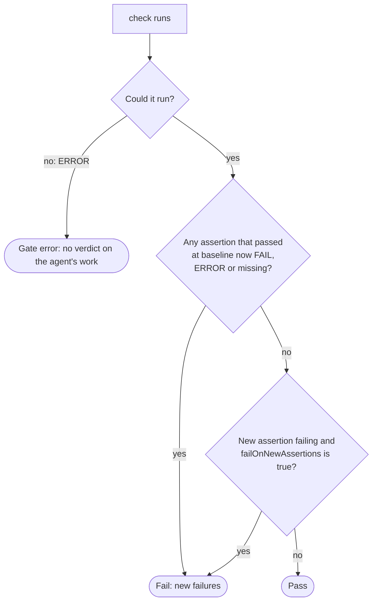

# Write a gate

This guide gets you from nothing to a working gate for your project: either the
built-in **command gate**, configured to run your test suite, or a **custom
gate** you write yourself. It is for developers whose project needs a check beyond the ready-made
ones in `delivery.config.json`. You do not need to read any source to follow it.

The `npm run demo:*` commands in this guide need a clone of the harness repository; the snippets
need only the installed package.

## What a gate is

The gate is the only proof the harness accepts that a change is good. An agent's
word that it finished is never taken as proof; the gate is run instead.

A gate measures a [worktree](glossary.md#working-copy) (the harness's copy of your project that one run works in) and returns a **report**: a list of named
**assertions**, each passing or failing. The harness measures it twice per [surface](glossary.md#surface) (one task's run):

1. **`baseline(ctx)`**, once, before any agent touches the worktree. The report
   is stored in the case file and never changes for the rest of the surface.
2. **`check(ctx)`**, after every attempt, against the changed worktree.

The harness then compares the two with a fixed rule (see [How the verdict is
reached](#how-the-verdict-is-reached)). Your gate never decides pass or fail for the change; it only
reports what it measured.

Everything in this guide is imported from the harness's single entry point,
`delivery-service`. Install it in your project as
[Get started](getting-started.md) describes, then run the snippets with
`npx tsx`.

## The contract

A gate is any object with two methods:

```ts
import type { GateContext, GateReport } from "delivery-service";

interface Gate {
  baseline(ctx: GateContext): Promise<GateReport>;
  check(ctx: GateContext): Promise<GateReport>;
}
```

Each method receives a `GateContext`:

| Field | What it is |
|---|---|
| `worktreePath` | The absolute path of the worktree to measure. Measure this, and nothing else. |
| `taskDef` | The surface's task definition, as pinned in the case file. Most gates ignore it. |
| `gateRef` | The gate reference that selected this gate, as pinned in the case file. |
| `baseBranch` | The branch the run started from and its work lands on, as pinned in the case file, or `null` for a run that recorded none. Most gates ignore it. |
| `env` | The environment the gate's command should run with. Unset means the process's own. |
| `guards` | A workflow step's own guard switches. Unset outside a workflow; most gates ignore it. |
| `itemId` | The work-source item the run delivers. Unset outside `delivery run --sources`. |

and must return a `GateReport`:

| Field | What it is |
|---|---|
| `status` | `"PASS"` if the gate ran and measured the worktree, whatever the assertions say. `"ERROR"` if it could not measure at all. Avoid `"FAIL"`: the verdict reads it as `"PASS"`. |
| `assertions` | One entry per thing measured: `{ id, outcome, detail }`. `outcome` is `"PASS"`, `"FAIL"` or `"ERROR"`. |
| `detail` | Optional. On an `"ERROR"` report, a sentence saying why the gate could not run. |

## Choosing a gate

A surface pins its gate in the case file header as a `gateRef`. There are two
kinds:

```ts
// The built-in command gate: run a shell command and parse what it prints.
{ type: "command", command: "npm test -- --reporter=tap", parseMode: "tap" }

// A custom gate: load a module you wrote.
{ type: "custom", modulePath: "/abs/path/to/json-gate.mjs", exportName: "default" }
```

Both accept an optional `failOnNewAssertions: true` (see [How the verdict is
reached](#how-the-verdict-is-reached)). Pass the `gateRef` to `create()` along with the rest of
the header, exactly as in [Making your first invocation](configuring-a-role.md#making-your-first-invocation). A `gateRef` the
harness cannot understand (an unknown `type`, an unsupported `parseMode`) is not
an exception: it resolves to a gate whose every report is `"ERROR"`, naming what
was wrong.

## The built-in command gate

For the common checks you need not write this out at all: `delivery.config.json` takes a
ready-made check by name, such as `{ "type": "file-exists", "path": "CHANGES.md" }`. Each of the
five ready-made checks is turned into a command gate, judged by exit code. The five names are
listed in [Configuration reference](configuration-reference.md#ready-made-checks).

Most projects need nothing more. The command runs with `/bin/sh -c` inside the
worktree, and its output is parsed according to `parseMode`:

| `parseMode` | Reads | One assertion per | Assertion `id` |
|---|---|---|---|
| `"tap"` | standard output as TAP | `ok` / `not ok` line | `"<number> - <description>"` |
| `"junit"` | standard output as JUnit XML | `<testcase>` | `"<classname>::<name>"` |
| `"exitcode"` | the exit code only | the whole command | `"exit:<command>"`, passing on exit 0 |

Prefer `"tap"` or `"junit"` whenever your runner can emit them. With
`"exitcode"` the whole suite is a single assertion, so a suite that was already
failing at baseline stays one failing assertion, and a new failure inside it goes unseen.

`"checkOnly": true` judges the work only after it is done: the baseline runs nothing, so every
assertion the check reports is new, and a new failing one counts against the work. The
`file-exists` ready-made check is written out this way.

Every gate command runs with `DELIVERY_STEP_START` set to the commit the work started from (in a workflow, the commit the current step started from), so a check can judge what was added since.

A written-out command gate may also name `setup` and `teardown`:

```json
{ "type": "command", "command": "npm test", "parseMode": "exitcode",
  "setup": "docker compose up -d", "teardown": "docker compose down" }
```

`setup` and `teardown` run around the baseline (unless `checkOnly` is set) and around every check.
`setup` runs before the command, in the same worktree. If it fails, the gate reports an error
(the check could not run), never that the work failed its checks. `teardown` runs after the
command whatever happened, including after a setup that failed; a failing teardown is warned about
and does not change the verdict. Both are shown to the agent and by `delivery validate`. The
ready-made checks take neither.

A test that fails does not make the report `"ERROR"`; it is a `"FAIL"`
assertion in a `"PASS"` report. The report is `"ERROR"` only when the gate could
not measure: the command could not be run, it ran past the five-minute timeout,
its output could not be parsed (no TAP lines, no `<testcase>` elements), or two
assertions came out with the same `id`.

To try it against a real suite:

```bash
npm run demo:gate-slice-2
```

## A minimal custom gate

Write a custom gate when what you want to measure is not a test run. This one
asserts that every `.json` file at the top of the worktree parses:

```js
// json-gate.mjs
import { readdirSync, readFileSync } from "node:fs";
import { join } from "node:path";

function measure(ctx) {
  const files = readdirSync(ctx.worktreePath).filter((f) => f.endsWith(".json")).sort();
  return {
    status: "PASS",
    assertions: files.map((file) => {
      try {
        JSON.parse(readFileSync(join(ctx.worktreePath, file), "utf-8"));
        return { id: `json:${file}`, outcome: "PASS", detail: "parses" };
      } catch (err) {
        return { id: `json:${file}`, outcome: "FAIL", detail: err.message };
      }
    }),
  };
}

export default {
  baseline: async (ctx) => measure(ctx),
  check: async (ctx) => measure(ctx),
};
```

Reference it from the case file header:

```ts
{ type: "custom", modulePath: "/home/me/gates/json-gate.mjs" }
```

`exportName` selects a named export instead of `default`, so one module can hold
several gates.

From the command line, the same shape goes in `delivery.config.json` under `gate`, so a project
names its gate once and writes no wiring code:

```json
{ "gate": { "type": "custom", "modulePath": "./gates/json-gate.mjs" } }
```

`delivery run` loads the module before it starts, so a wrong path, or an export missing
`baseline` or `check`, stops the command with the path named rather than failing part way
through a run.

**The module is loaded from outside the worktree.** A relative `modulePath` is
resolved against the repository root (`repoPath`), never the worktree the surface
is running in, so the agent being judged cannot edit the gate to hide a failure instead of fixing it. An absolute path works too.

To load and call it yourself, save the gate from [A minimal custom gate](#a-minimal-custom-gate) as `/tmp/my-run/json-gate.mjs` and run:

```ts
import { mkdirSync, writeFileSync } from "node:fs";
import { loadCustomGate } from "delivery-service";

// A worktree for the gate to measure, with one valid JSON file in it.
mkdirSync("/tmp/my-run/tree", { recursive: true });
writeFileSync("/tmp/my-run/tree/good.json", "{}");

// The first argument is the repository root a relative `modulePath` resolves
// against. It is required, so a gate can never be loaded from whichever
// directory the process happens to be running in.
const gate = await loadCustomGate("/tmp/my-run", "/tmp/my-run/json-gate.mjs");
const ctx = {
  worktreePath: "/tmp/my-run/tree",
  taskDef: {},
  gateRef: { type: "custom", modulePath: "/tmp/my-run/json-gate.mjs" } as const,
};
console.log(await gate.baseline(ctx));
```

It prints:

```text
{
  status: 'PASS',
  assertions: [ { id: 'json:good.json', outcome: 'PASS', detail: 'parses' } ]
}
```

The harness wraps every custom gate, so it reports a mistake in yours and never
crashes:

| Mistake | What happens |
|---|---|
| The module cannot be imported | `loadCustomGate` throws `GateModuleLoadFailure`; during a run, the report is `"ERROR"` |
| The export is missing, or lacks `baseline` or `check` | `loadCustomGate` throws `InvalidGateExport`, before either method is called; during a run, the report is `"ERROR"` |
| A method throws, or its promise rejects | the report is `"ERROR"`, naming the module, the method and the message |
| A method returns something that is not a `GateReport` | the report is `"ERROR"` |
| Two assertions share an `id` | the report is `"ERROR"`, naming the duplicate |

To watch each of those happen:

```bash
npm run demo:gate-slice-3
```

## What `baseline` and `check` must guarantee

The verdict is only as honest as the reports. A gate must:

1. **Measure the same thing both times.** `baseline` and `check` are usually the
   same function, as in [A minimal custom gate](#a-minimal-custom-gate). If they differ, a change can look like a regression,
   or hide one.
2. **Give each assertion a stable `id`.** The same thing measured on unchanged
   code must come out with the same `id` every time. Assertions are matched
   across the two reports by `id` alone; an `id` built from a timestamp, a random
   number or a line number that shifts turns every run into a regression.
3. **Give each assertion a unique `id`** within one report.
4. **Report what you measured, including failures.** A failing assertion at
   baseline is fine: it is a known failure and is never held against the agent.
   Do not leave it out.
5. **Return `"ERROR"` only when you could not measure at all.** An `"ERROR"`
   baseline is not stored; the harness sends the surface to gate maintenance to
   repair the environment, then measures again. An `"ERROR"` check is judged a
   gate error, not a failure of the agent's work.
6. **Leave the worktree as you found it.** A gate measures; it does not change
   what it measures.

## How the verdict is reached

After each `check`, the harness compares it with the stored baseline:



A **new failure** is any assertion that:

| At baseline | At check | New failure? |
|---|---|---|
| `PASS` | `FAIL` or `ERROR` | yes |
| `PASS` | **missing** (`ABSENT`) | **yes** |
| `PASS` | `PASS` | no |
| `FAIL` or `ERROR` | anything | no: it was already failing |
| not present | `FAIL` or `ERROR` | only with `failOnNewAssertions: true` |
| not present | `PASS` | no |

**The ABSENT rule** (second row) is the one to design your gate around: an
assertion that passed at baseline and is missing from the check counts as a new
failure. Otherwise deleting a failing test, or a file your gate measures, would
make the failure disappear. With the gate in [A minimal custom gate](#a-minimal-custom-gate), deleting `good.json` fails the
check with `json:good.json` reported as `ABSENT`. It is also why `id`s must be
stable: a renamed `id` reads as the old one vanishing.

The change passes when there are no new failures and the check was not
`"ERROR"`. An `"ERROR"` check is a gate error: no new failures are recorded,
because a gate that could not run says nothing about the agent's work.

To compute a verdict yourself, or to watch the rule applied end to end:

```ts
import { computeDelta } from "delivery-service";

const delta = computeDelta(baselineReport, checkReport, { failOnNewAssertions: false });
// { pass, newFailures: [{ id, baselineOutcome, checkOutcome, detail }], class: "fail" | "error" | null }
```

```bash
npm run demo:gate-slice-1   # the verdict rule, ABSENT included
npm run demo:gate-slice-4   # resolving a gateRef into a gate
npm run demo:gate-slice-5   # a baseline and its checks persisted in a case file
```

## What the harness adds to your report

Whatever your check reports, the harness adds its own results (the [guards](glossary.md#guard)): whether the work deleted or
renamed a test, changed how tests run, added a skip marker to a test, or hid a test setting from
git. "Changed how tests run" includes `.gitignore` (it decides which files the other guards can
see) and the project's `Makefile` or equivalent build file (it can redefine what a `test` target
actually runs) alongside the obvious test-runner configs and CI files, protected on every run,
not only inside a pack's own fix. The harness works them out from the commit the task started from, and a
failure among them fails the round even when your check passes.

## See also

- [Write a closer](writing-a-closer.md): decide what happens to work that passes.
- [Set up a project](project-configuration.md): name your gate in `delivery.config.json`.
- [Test your pipeline](testing-your-pipeline.md): try a gate against the scripted agent.
- [Configure a role](configuring-a-role.md): the agent roles a gate's verdict feeds.
- [Configuration reference](configuration-reference.md#guards): the full list of guards.
